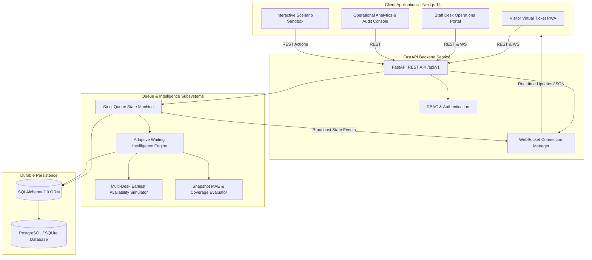

# QueueLess — Your Time Matters
### Production-Minded AI Queue Intelligence & Virtual Ticket Platform

[](https://www.python.org/)
[](https://fastapi.tiangolo.com/)
[](https://nextjs.org/)
[](https://tailwindcss.com/)
[-brightgreen.svg)]()
[]()

---

## 1. Executive Summary & Vision

**QueueLess** is an intelligent virtual queue management platform designed for university administrative offices, student service hubs, medical clinics, municipal centers, and banks.

Traditional physical queues waste valuable student and visitor time, create overcrowded waiting lobbies, and leave people anxious about when they will be served. Basic buzzer or token systems merely assign numbers without dynamic intelligence.

**QueueLess** introduces the **Adaptive Waiting Intelligence Engine (AWIE)**—a deterministic multi-desk scheduling simulation that combines real-time queue states, empirical duration distributions, counter availability, and operational interruptions to deliver dynamic waiting-time predictions with transparent **P10–P90 uncertainty ranges**.

---

## 2. Key Capabilities & Hackathon Highlights

- 🎫 **Instant Virtual Tickets**: Join queues via browser without downloading an app. Receive a digital pass with live position ahead and token numbering.
- 🧠 **Adaptive Waiting Intelligence Engine (AWIE)**: Counter-aware discrete scheduling simulation predicting wait time across parallel desks with heterogeneous service eligibility.
- 📊 **Transparent Prediction Uncertainty**: Honest P10–P90 confidence intervals that adapt when desks pause or service variance increases.
- 🚶 **Smart Departure Recommendations**: Combines visitor walking/travel buffers with safety margins to tell visitors exactly when to leave their dorm, café, or study hall.
- 🖥️ **Live Staff Operations Desk**: Full desk management interface with `Call Next`, `Start Service`, `Complete Service`, `Mark No-Show`, `Requeue`, and counter pause controls.
- ⚡ **Bi-directional WebSocket Live Sync**: Instant push updates (`TOKEN_JOINED`, `TOKEN_CALLED`, `COUNTER_PAUSED`, `SERVICE_COMPLETED`) without client polling.
- 🧪 **Interactive Simulation Sandbox**: Prominently marked **SIMULATED DATA** playground allowing judges to inject arrivals, advance services, pause counters, and trigger no-shows.
- 📈 **Operational Analytics & Evaluation**: Live tracking of Mean Absolute Error (MAE), prediction interval coverage %, desk utilization, and hourly throughput with one-click CSV export.

---

## 3. System Architecture



---

## 4. Repository Structure

```
queueless/
├── backend/
│   ├── app/
│   │   ├── api/               # API Routers (auth, facilities, queues, tickets, staff, admin, analytics, demo)
│   │   ├── models/            # SQLAlchemy 2.0 models (User, Facility, Service, Queue, QueueEntry, Counter, etc.)
│   │   ├── schemas/           # Pydantic v2 validation and response models
│   │   ├── services/
│   │   │   ├── queue_engine.py       # Strict state transitions & ACID transaction safety
│   │   │   ├── prediction_engine.py  # Adaptive Waiting Intelligence Engine (AWIE)
│   │   │   ├── analytics_service.py  # Live operational metrics & accuracy tracking
│   │   │   └── demo_simulator.py     # Scenario generator & seed dataset
│   │   ├── websocket/         # High-throughput WebSocket connection manager
│   │   ├── config.py          # Environment settings
│   │   ├── database.py        # Database connection & session factory
│   │   └── main.py            # FastAPI application entrypoint
│   ├── tests/                 # Pytest unit & integration test suite
│   ├── Dockerfile
│   └── requirements.txt
├── frontend/
│   ├── app/
│   │   ├── page.tsx           # Premium landing page
│   │   ├── join/              # Visitor queue entry & form
│   │   ├── ticket/[ticketId]/ # Live virtual ticket with countdown & uncertainty range
│   │   ├── staff/             # Staff live operations desk
│   │   ├── admin/             # Analytics dashboard & audit logs
│   │   ├── demo/              # Interactive scenario simulator
│   │   ├── app/               # Visitor portal (my tickets)
│   │   ├── login/             # Authentication & role selector
│   │   ├── features/          # Platform capabilities
│   │   └── globals.css        # Arctic Blue design system tokens
│   ├── components/            # Navbar, Footer, ThemeToggle
│   ├── lib/                   # API client & WebSocket handler
│   ├── Dockerfile
│   └── package.json
├── docs/
│   ├── architecture.md        # Comprehensive architecture & design principles
│   ├── prediction.md          # Mathematical algorithm & calibration formulation
│   └── build-status.md        # Phase tracking & test verification logs
├── docker-compose.yml         # Full-stack Docker deployment configuration
├── .env.example
└── README.md
```

---

## 5. Quickstart & Local Setup

### Prerequisites
- Python 3.12+
- Node.js 18+ and npm
- (Optional) Docker & Docker Compose

### 1. Backend Setup
```bash
# Navigate to backend
cd backend

# Create and activate virtual environment
python -m venv venv
# On Windows:
.\venv\Scripts\activate
# On Linux/macOS:
source venv/bin/activate

# Install dependencies
pip install -r requirements.txt

# Run backend test suite (11/11 tests passing)
pytest tests -v

# Start FastAPI server
uvicorn app.main:app --reload --port 8000
```
Backend will start on `http://localhost:8000`.  
Interactive Swagger API docs available at `http://localhost:8000/api/v1/docs`.

### 2. Frontend Setup
```bash
# Navigate to frontend (in a separate terminal)
cd frontend

# Install dependencies
npm install

# Run frontend development server
npm run dev
```
Open your browser at `http://localhost:3000`.

---

## 6. Full Docker Deployment

To launch the complete production stack (PostgreSQL + FastAPI + Next.js):
```bash
docker-compose up --build
```
- Frontend: `http://localhost:3000`
- Backend API: `http://localhost:8000/api/v1`
- PostgreSQL: `localhost:5432`

---

## 7. Interactive 5-Minute Hackathon Demo Script

For judges and evaluators reviewing the platform:

1. **Step 1 (The Landing Page)**: Open `http://localhost:3000/`. Review the hero preview showing both the visitor mobile pass and the staff live counter side-by-side. Toggle Dark/Light mode via the sun/moon button.
2. **Step 2 (The Visitor Experience)**: Click **"Join Queue"** (`/join`). Enter your name, adjust the walking travel buffer slider (e.g. 8 minutes), and click **"Join Queue & Get Ticket"**.
3. **Step 3 (Live Virtual Ticket)**: Note your assigned token number (e.g. `TRA-005`), real-time countdown, P10–P90 uncertainty confidence interval, and the smart departure recommendation.
4. **Step 4 (The Live Simulation Test)**: Navigate to `/demo`. Open the simulator in one window and your ticket in another:
   - Click **"Pause Desk #2"**: Immediately observe the ticket's wait time increase and the explanation note that desk capacity was reduced.
   - Click **"Resume Desk #2"**: Notice the estimate immediately recovers as desk capacity is restored.
   - Click **"Call Next"** and **"Complete Active"** to observe live queue progression.
5. **Step 5 (Analytics & MAE Evaluation)**: Click **"Analytics"** (`/admin`). Review the Mean Absolute Error (MAE), prediction range coverage %, hourly throughput chart, and click **"Export Analytics (CSV)"** to inspect raw operational records.

---

## 8. Test Verification Results

All unit and integration tests execute with 100% pass rate:
```
============================= test session starts =============================
platform win32 -- Python 3.12.0, pytest-9.1.1
collected 11 items

tests/test_api_workflows.py::test_health_check PASSED                    [  9%]
tests/test_api_workflows.py::test_facilities_and_services_endpoints PASSED [ 18%]
tests/test_api_workflows.py::test_visitor_join_and_ticket_flow PASSED    [ 27%]
tests/test_api_workflows.py::test_simulation_scenario_controls PASSED    [ 36%]
tests/test_api_workflows.py::test_analytics_and_csv_export PASSED        [ 45%]
tests/test_prediction_engine.py::test_prediction_calculation_and_uncertainty_bounds PASSED [ 54%]
tests/test_prediction_engine.py::test_counter_pause_impact_on_estimates PASSED [ 63%]
tests/test_queue_engine.py::test_join_queue_and_fifo_priority_ordering PASSED [ 72%]
tests/test_queue_engine.py::test_legal_state_machine_transitions PASSED  [ 81%]
tests/test_queue_engine.py::test_illegal_state_transition_rejection PASSED [ 90%]
tests/test_queue_engine.py::test_counter_pause_and_resume PASSED         [100%]

======================= 11 passed in 0.66s =======================
```

Frontend production build (`npm run build`):
```
✓ Compiled successfully
✓ Generating static pages (14/14)
✓ Finalizing page optimization
All 14 routes statically compiled and validated.
```

---

## 9. Security & Privacy

- **RBAC**: Strict role boundaries for `VISITOR`, `STAFF`, and `ADMIN`.
- **Public Privacy**: Broadcast WebSockets transmit only anonymous tokens (`TRA-005`) and counter codes; visitor names and phone numbers are never leaked.
- **ACID State Transitions**: Enforced legal state transitions (`WAITING` &rarr; `CALLED` &rarr; `IN_SERVICE` &rarr; `COMPLETED`) with transactional safety.
- **Idempotency**: Join queue submissions protected against duplicate clicks.

---

## 10. License

QueueLess is released under the **MIT License**.
*QueueLess — Your Time Matters.*
