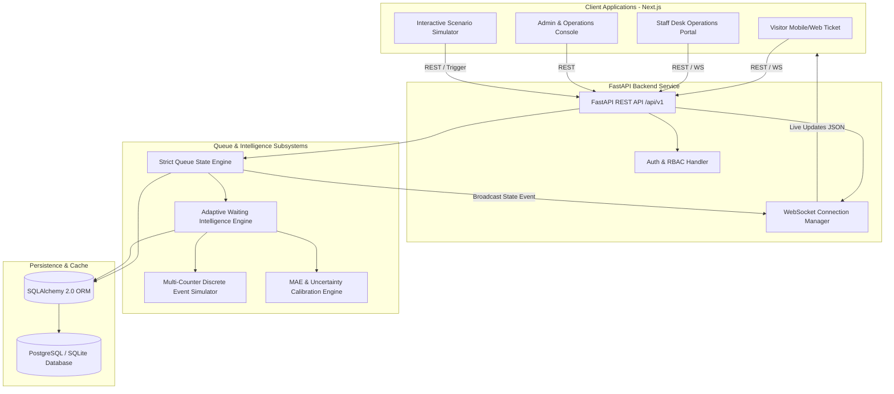

# QueueLess Architecture & System Design

## Architectural Principles

1. **Deterministic Statistical Intelligence**:
   - No external paid blackbox LLM dependencies for critical wait-time predictions.
   - Counter-aware discrete scheduling simulator assigning waiting entries ahead to the earliest available eligible counter.
   - P10-P90 uncertainty confidence bounds based on historical service duration variance and active counter status.

2. **Strict Queue State Machine**:
   - Legal state transitions enforced at service layer:
     - Entry: `WAITING` -> `CALLED` -> `IN_SERVICE` -> `COMPLETED`
     - Terminal/Alternative: `WAITING` -> `CANCELLED`, `CALLED` -> `NO_SHOW`, `CALLED` -> `WAITING` (authorized requeue)
   - Counter states: `AVAILABLE`, `BUSY`, `PAUSED`, `OFFLINE`.
   - Concurrency protection: Atomic transactions, unique token number generation per session, row-level locking where applicable.

3. **Hybrid Database Compatibility**:
   - Zero-config SQLite out-of-the-box for rapid local testing and hackathon judging without external daemon setup.
   - Full PostgreSQL support for production deployments via `DATABASE_URL`.

4. **Bi-directional Real-Time Synchronization**:
   - High-throughput WebSocket hub (`/ws/queues/{queue_id}`) pushes atomic state events (`TOKEN_JOINED`, `TOKEN_CALLED`, `COUNTER_PAUSED`, etc.) to all connected clients.
   - Client-side reconnection with exponential backoff and recovery state synchronization.
